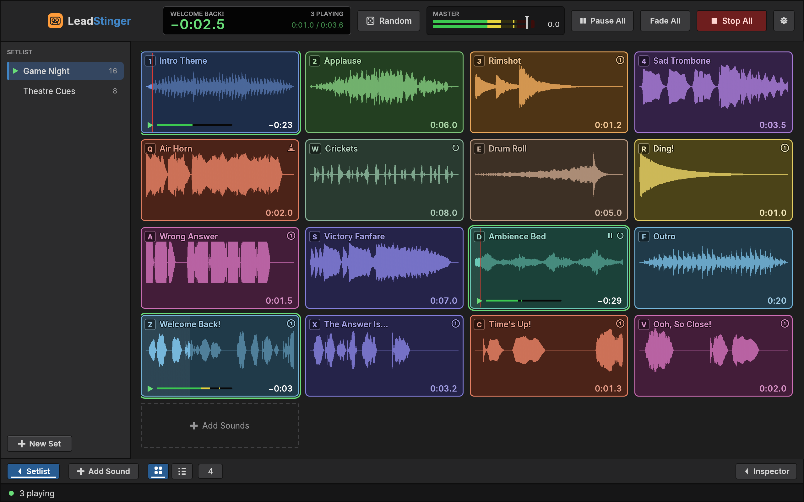
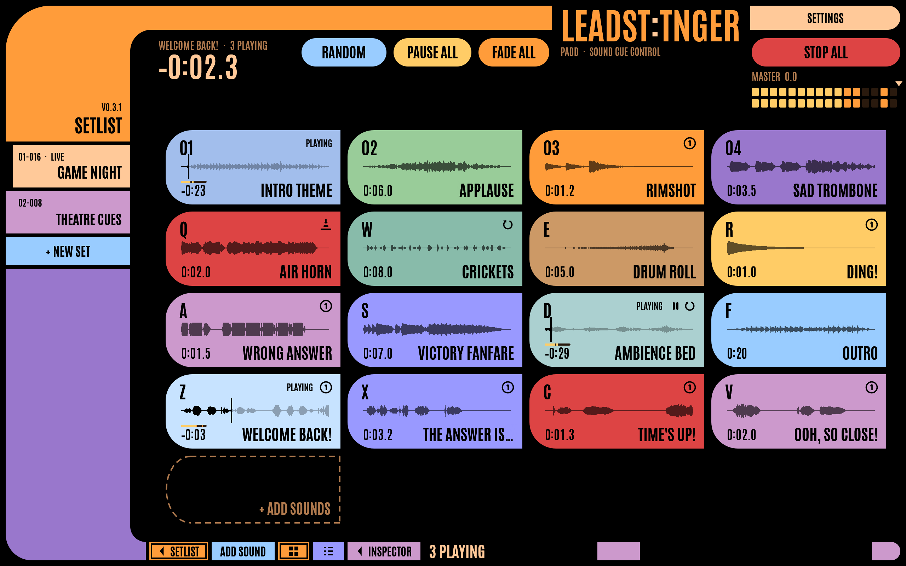

# LeadStinger

*A pun on "lead singer": a stinger is a short sound cue.* LeadStinger is a live
soundboard for macOS and Linux. It fires sound clips instantly from a grid of tiles or
a cue list, for podcasts, streams, theatre and game nights. Everything it does can also
be scripted from the command line, so key binds, Stream Deck buttons and AI agents can
drive it.





The cue list in both themes: [Console](docs/screenshots/console-list.png), [Panel](docs/screenshots/panel-list.png).

It's written in Rust, with [egui](https://github.com/emilk/egui) for the interface,
[cpal](https://github.com/RustAudio/cpal) for audio output and
[symphonia](https://github.com/pdeljanov/Symphonia) for decoding. [SPEC.md](SPEC.md)
describes how it behaves.

Originally made as a gift for Chris Fisher.

## Features

- **Sets**: named boards in a sidebar. Sounds keep playing when you switch sets.
- **Grid and cue list**: the cue list plays its rows in order, one at a time: Enter
  plays the selected row (again stops it), each row's armed mark clears once it has
  played, Continuous (with a cross-fade) or Queued, Reset List, and cue and set notes.
  Space is Pause All everywhere.
- **Per-tile settings**: hotkey, colour, volume, fade in and out, trim (on a waveform),
  and the pad options, toggle buttons in the inspector and badges on the pad: Loop, Solo,
  Pausable (a second press pauses), One-shot (a second press starts it again), Hold
  (plays while held; with Pausable, letting go pauses) and Disabled. Every setting is non-destructive; audio files are never modified.
- **Shaping a clip**: gain above 0 dB and Normalise, fade shapes, speed (tape style),
  pitch (keeping the speed), markers to jump to, and a vamp section that loops until the
  next press (or GO) lets it play on to the end.
- **Live control**: MIDI controllers with pad lights, OSC with feedback, system-wide keys,
  beds that duck under other tiles or your voice, recording into a tile, instant replay,
  outputs with per-tile sends (one tile to the house, a headphone cue mix and a stream,
  each at its own level; sends on one device stay sample-aligned, sends on two devices
  drift apart with their clocks) and a preview output, and undo.
- **Tile visuals**: every tile shows the waveform of the region it plays. A tile can
  also have a picture or icon, under or over the waveform. Cover art embedded in MP3,
  M4A and FLAC files is used automatically as a faint underlay.
- **No modes**: click a tile to select it for the inspector, double-click to play it
  (keys, pads and GO always play); drag to reorder. A set can be **locked** so a show
  can't be changed by accident; its tiles still play. A bottom bar shows or hides the
  sets and the inspector.
- **Getting sounds in**: drag and drop from the file manager, copy files there and paste
  them here (⌘/Ctrl+V), or use Add Sounds…. WAV, AIFF, MP3, AAC/M4A, FLAC and Ogg Vorbis;
  with [ffmpeg](#ffmpeg-for-ac-3-dts-and-video-files) also AC-3, E-AC-3, DTS and the audio
  of video files. Files are copied into the library, so it's self-contained.
- **Mixing**: per-sample fades, resampling, gapless loops, master volume, Stop All (Esc)
  and a choice of output device. Surround files are downmixed to stereo, or mixed your
  own way per channel (left, right, both or mute, with a level).
- **Two themes**: *Console*, a dark mixing-desk look (with Light and System
  appearances), and *Panel*, a retro sci-fi control panel set in condensed capitals,
  titled LEADST:TNGER.
  Choose in View ▸ Theme or Settings.
- **Your own themes**: a `.lstheme` is a FigCraft (or Figma) variables export plus a
  name, so you design colours, sizes and fonts there and import the result
  (Settings ▸ Theme ▸ Import…, `theme.import`). Edits to a theme in use show at once.
  See [Your own themes](#your-own-themes).
- **Low vision**: zoom from 50 to 300 % (⌘/Ctrl + and −), a high-contrast appearance
  in both themes, and state shown by symbols and words as well as colour.
- **Menus**: the native menu bar on macOS and a menu bar in the window on Linux, built
  from one model, so every item and shortcut matches.
- **Scriptable**: every action is a command for `leadstinger-cli`. It drives the running
  app, or edits the library while the app is closed.
- **Headless**: `leadstinger-cli serve` plays with no window, for a box with speakers
  and no screen.
- **Export audio**: write tiles, or a whole set, to WAV or FLAC with the trim, fades,
  volume, gain, speed, pitch and channel mix applied (File ▸ Export Audio…,
  `leadstinger-cli set.render ~/Show/Cues`).
- **Set files**: export a set (or all of them) to one `.lsset` file, with every clip,
  picture and setting, and import it into any other library (double-click one, and
  LeadStinger asks before adding it). Starter packs hand someone a
  ready-made board that fills their library on first launch. See
  [starter/README.md](starter/README.md).
- **Import from Farrago**: File ▸ Import Set… also takes a set exported from Farrago
  (`.farragoset`, or the same zipped), with its sounds, titles, colours, layout and tile
  options, and lists what didn't carry over. See
  [docs/FARRAGO-IMPORT.md](docs/FARRAGO-IMPORT.md).

## Install

### Nix (Linux, and macOS on Apple silicon)

```bash
nix run github:weckere/leadstinger
```

or add it to a profile, which also installs `leadstinger-cli` and, on Linux, a launcher
entry and icon:

```bash
nix profile install github:weckere/leadstinger
```

### Release downloads

The [releases page](https://github.com/weckere/leadstinger/releases) has:

- **macOS**: `LeadStinger.app` (universal), zipped. It isn't notarised, so the first
  time, right-click it in Finder and choose Open. `leadstinger-cli` is inside the
  bundle, in `Contents/MacOS/`; link it onto your PATH with
  `ln -s /Applications/LeadStinger.app/Contents/MacOS/leadstinger-cli ~/.local/bin/`.
- **Linux** (x86_64 and aarch64): an AppImage, and a tarball with both binaries, the
  `.desktop` file and the icon. The tarball needs glibc 2.35 or later (Ubuntu 22.04,
  Debian 12 or newer). The AppImage starts through an unprivileged user namespace, which
  Ubuntu 24.04 and later block by default (`cannot write uid_map: Operation not
  permitted`); there, use the tarball, or load the AppArmor profile given in the release
  notes.

### ffmpeg, for AC-3, DTS and video files

Importing AC-3, E-AC-3, DTS or TrueHD audio, or the sound of a video file (MKV, MOV, MP4,
VOB, ...), converts it once to FLAC with [ffmpeg](https://ffmpeg.org), keeping every
channel. ffmpeg is optional and installed separately: the Nix package brings
`ffmpeg-headless` along, but the macOS app, the AppImage and the tarballs don't include
it. Everything else works without it.

- macOS: `brew install ffmpeg`
- Debian/Ubuntu: `sudo apt install ffmpeg`; Fedora: `sudo dnf install ffmpeg-free`
- Nix: `nix profile install nixpkgs#ffmpeg-headless`

LeadStinger looks for `$LEADSTINGER_FFMPEG`, then `ffmpeg` on PATH, then the usual
Homebrew, MacPorts and Nix folders.

### From source

You need a Rust toolchain (1.95 or newer), a C++ compiler and libclang (the pitch shifter
is C++, bound with bindgen). On Linux you also need the development packages for ALSA,
xkbcommon, Wayland, X11 (Xcursor, Xi, Xrandr), OpenGL and GTK 3, plus `pkg-config`. With Nix, `nix develop` gives you all of it:

```bash
nix develop -c cargo run --release
```

To make a macOS app bundle in `dist/`:

```bash
nix develop -c scripts/bundle-macos.sh
```

To make a Linux AppImage in `dist/` (needs Nix):

```bash
scripts/build-appimage.sh
```

To build for iPadOS (a first version, simulator-first; see [docs/IPAD-PLAN.md](docs/IPAD-PLAN.md)),
on a Mac with Xcode and a rustup toolchain (the nix shell has no iOS standard library):

```bash
rustup target add aarch64-apple-ios-sim aarch64-apple-ios
scripts/ios-build.sh --run        # build, install and launch in the iPad Pro 13-inch simulator
```

To run it on your own iPad (a development-signed build, installed with `devicectl`; needs
`nix` for xcodegen, the iPad paired with Developer Mode on, and your team id):

```bash
LEADSTINGER_TEAM=XXXXXXXXXX scripts/ios-install.sh
```

To try it with a generated demo library, without touching your own:

```bash
LEADSTINGER_DATA_DIR=/tmp/ls-demo LEADSTINGER_DEMO=1 cargo run --release
```

## Keys

| Key | Action |
|---|---|
| tile hotkey | trigger that tile (a pad's key follows its row on the board: row 1 `1`–`=`, row 2 `Q`–`]`, row 3 `A`–`'`, row 4 `Z`–`/`, rows 5–8 the same with Option/Alt; a key set by hand stays with its pad) |
| Space | Pause All; again to carry on |
| Enter | cue list: play the selected cue, or stop it while it plays |
| ↑ / ↓ | cue list: select the cue above / below without playing (when no cue row has focus) |
| Esc / Shift+Esc | Stop All with a fade / at once |
| ⌘/Ctrl + O | add sounds |
| ⌘/Ctrl + V | paste sounds copied in a file manager (outside text fields) |
| ⌘/Ctrl + Z / Shift+Z | undo / redo a change to sets or tiles (outside text fields) |
| ⌘/Ctrl + Shift+N | new set |
| ⌘/Ctrl + E | switch Perform and Edit |
| ⌘/Ctrl + 1 / 2 | grid / list view |
| ⌘/Ctrl + F | find tiles in every set (Enter plays the first) |
| ⌘/Ctrl + ] / [ | next / previous set |
| ⌘/Ctrl + , | settings |
| ⌘/Ctrl + = (or +) / − / 0 | zoom in / out / back to 100 % |

Without a mouse (every control also has hover text, and a name and role for VoiceOver and
Orca):

| Key | Action |
|---|---|
| Tab / Shift+Tab | move the focus: menu bar, toolbar, sets, inspector, board (a ring marks it) |
| arrow keys | move the focus between tiles in the grid, or cues in the list |
| Enter | play the focused tile, which the focus also selects (in a cue list, play the selected cue or stop it) |
| ⌘/Ctrl + ↑ / ↓ (or ← / →) | move the focused tile one place earlier or later (in a locked set, or with no tile focused, ⌘/Ctrl + ↑ / ↓ is the master volume) |
| ← / → | nudge a focused trim or vamp handle (Shift: 0.1 s steps), or the focused master meter |
| Esc | leave the focus (and Stop All, as always) |

Tile hotkeys never fire while a text field has focus (a selected pad doesn't stop them).

## Accessibility

LeadStinger is meant to be run without seeing it, and by people who see it poorly.

- **Screen readers**: VoiceOver on macOS (⌘F5) and Orca on Linux (GNOME, KDE and other
  AT-SPI desktops) read every control by role and name, through AccessKit. A tile reads
  its title, number, key, options and live state ("Air Horn, tile 5, key 5, hold,
  playing, 1.2 seconds left"); a cue row starts with its cue number and says when
  it's the next cue and when it has played; the master meter is a slider in dB. Hover text, the same words for
  sighted users, is each control's description.
- **Announcements**: without moving your focus, the screen reader says what changed:
  "Playing Air Horn" when a tile starts (however it was started), a cue list's next cue,
  Stop All, an import that finished or failed, an opened set file or QuipClipper link,
  and every message in the status bar.
- **Spoken cue names** (Settings ▸ Speech, off by default): the system voice says each
  tile's title as it starts, with or without a screen reader. On macOS it uses `say`, in
  your headphones when Preview to another output is on with a device chosen; on Linux
  it uses speech-dispatcher (`spd-say`), on speech-dispatcher's own output.
- **Keyboard only**: every control is reachable with Tab, with a focus ring; the tables
  under [Keys](#keys) are the whole map, and Help ▸ Keyboard Shortcuts shows it in the app.
- **Zoom** from 50 to 300 % (⌘/Ctrl + / − / 0, View ▸ Zoom), and a **High Contrast**
  appearance for both themes (View ▸ Appearance) that meets WCAG AA. Playing, paused,
  next, disabled and selected are shown by symbols, words or patterns as well as colour,
  and tile colours have names.
- **The command line is a complete non-visual way to run a show.** Everything the window
  can do is a `leadstinger-cli` command with plain-text answers, so a terminal and a
  screen reader (or a braille display) are enough:

  ```bash
  leadstinger-cli sets                  # the sets, numbered
  leadstinger-cli list --set "Theatre Cues"   # its tiles: number, title, key, length
  leadstinger-cli cue.go                # cue list: play the selected cue; cue.next / cue.prev select
  leadstinger-cli trigger "Air Horn"    # or trigger key:1, or a tile number
  leadstinger-cli status                # what's playing, and the next cue
  leadstinger-cli stop-all
  leadstinger-cli watch                 # events as they happen, one per line
  ```

  `leadstinger-cli serve` plays with no window at all. The full list is
  [docs/CLI.md](docs/CLI.md).

## The command line

`leadstinger-cli` runs any of the app's commands. With the app open it acts on the
running app; with the app closed it edits the library directly.

```bash
leadstinger-cli trigger "Air Horn"          # exactly like pressing the tile's hotkey
leadstinger-cli trigger key:1               # the tile whose hotkey is 1
leadstinger-cli stop-all
leadstinger-cli add ~/Sounds/*.wav --set "Podcast"
leadstinger-cli tile.set "Air Horn" --hold --fade-out 0.5 --color red
leadstinger-cli --json status               # what's playing, as JSON
leadstinger-cli watch                       # events as JSON lines
leadstinger-cli commands                    # everything it can do
```

`--safe` refuses anything destructive, and `--ssh HOST` runs the command on another
machine. The full reference, generated from the app's own command list, is
[docs/CLI.md](docs/CLI.md).

[docs/RECIPES.md](docs/RECIPES.md) has short how-tos: a Stream Deck key, Bitfocus
Companion keys with countdowns, OBS with LeadStinger on its own track, a virtual
microphone (BlackHole on macOS, a PipeWire null sink on Linux) and event hooks with
`watch`.

### QuipClipper

[QuipClipper](https://github.com/weckere/quipclipper) finds a line in a movie or podcast
by its subtitles and cuts it. Its **Send to LeadStinger** button opens a
`leadstinger://quip?…` link, and LeadStinger downloads the clip into a new tile trimmed
to the line, keeping a couple of seconds either side for fine-tuning. Connect it once
with the server's API token, in **Settings ▸ QuipClipper** (its address and token, then
Connect) or from the shell:

```bash
leadstinger-cli quip.connect https://quip.example --token -   # paste the token, then Enter
```

Links from servers you haven't connected are refused and never fetched. On Linux with the
AppImage or a tarball, click Register Links in the same section, or run `leadstinger
--register-links`, once so links and `.lsset` set files open in LeadStinger. [docs/QUIPCLIPPER.md](docs/QUIPCLIPPER.md) has the link format and the
details.

### AI agents

[skills/leadstinger/SKILL.md](skills/leadstinger/SKILL.md) is an agent skill that teaches
a coding agent (Claude Code, or anything that reads `SKILL.md` files) to drive the app
through the CLI: build a board from a folder of sounds, trim and colour tiles, run a
show. Copy or link it into your agent's skills folder. Pair it with `--safe` if the agent
shouldn't delete anything.

## Linux notes

On Linux, audio goes through ALSA, so it works with PipeWire (`pipewire-alsa`) and
PulseAudio. Both X11 and Wayland are supported.

### MIDI controllers

Any MIDI pad controller or keyboard works, on every platform and with the window in the
background. Select a tile, click **MIDI…** on the inspector's Control tab and
press a pad. From the command line:

```bash
leadstinger-cli bind.learn "Air Horn"                    # then press a pad
leadstinger-cli bind.add midi:note:36 --tile "Air Horn"
leadstinger-cli bind.add midi:note:48 --command cue.go
leadstinger-cli bind.add midi:cc:7 --command master.volume --value volume
leadstinger-cli bind.add midi:note:49 --command duck.hold   # talk-over while held
leadstinger-cli midi.autoMap 36                           # unbound notes play tiles in order
leadstinger-cli midi.feedback --lit 127 --unlit 0          # pads light while their tile plays
leadstinger-cli midi.autoMap 36 --bank 16                 # 16 pads page through the set
leadstinger-cli bind.add midi:note:52 --command midi.pageUp  # ...with a pad for the next page
leadstinger-cli midi.feedback --colors launchpad           # pads in their tile's colour
leadstinger-cli bind.list
```

### OSC

For TouchOSC, Open Stage Control or Bitfocus Companion: `leadstinger-cli osc.enable --port 9000`
(or Settings), then send `/ls/tile/1/trigger 1`, `/ls/go`, `/ls/stopall`, `/ls/master 0.5`
or `/ls/cmd tile.play '{"tile": "Air Horn"}'` to 127.0.0.1:9000. It listens on this
machine only unless you add `--lan true`; OSC has no password, so keep that for a network
you trust. Destructive commands are refused. Add `--feedback 127.0.0.1:9001` and the app
sends each tile's state, title, colour (`/ls/tile/N/rgb`, `#RRGGBB`), remaining time,
progress and level (`/ls/tile/N/level`, 0-1 on the window's meter scale, ten times a
second while it plays), plus the cue pointer, the tile count and a countdown for what's playing
(`/ls/now/time`) back as they change, so buttons can light up and count down. A surface
that has just connected sends `/ls/resync` to get all of it at once. Every address is in
[docs/CLI.md](docs/CLI.md#osc), and [examples/](examples/) has ready-made layouts for
Bitfocus Companion, TouchOSC and Open Stage Control.

### Messages: cue lights and video

A tile can send OSC or MIDI when it starts and when it stops, to fire a lighting cue, a
video or another app with the sound. In the tile's inspector, under MESSAGES, write one per
line, or use the CLI:

```bash
leadstinger-cli tile.set "Thunder" --onStart "osc://127.0.0.1:8000/eos/cue/1/12/fire"
leadstinger-cli tile.set "Intro" --onStart 'osc://localhost:9010/video/play "intro"'
leadstinger-cli tile.set "Intro" --onStop "midi:noteoff:60:ch2 @IAC"
```

MIDI forms are `midi:note:60`, `midi:noteoff:60`, `midi:cc:20:val64` and
`midi:program:5`, with `:ch2` for the channel and `@name` to pick the output. OSC messages go
to this machine only unless OSC may use the network (`osc.enable --lan true`). A preview
sends nothing.

### System-wide keys

On macOS and in an X11 session, keys bound in LeadStinger work while another app has
focus: click **Key…** in a tile's inspector and press a combination (with Ctrl, Alt,
Shift or Cmd, or an F-key), or `leadstinger-cli bind.add key:Ctrl+Alt+1 --tile "Air Horn"`.

On Wayland, apps can't grab keys, so LeadStinger asks the desktop's global-shortcuts
portal for the same bindings (KDE Plasma, GNOME 48 and later, xdg-desktop-portal-hyprland);
the desktop may ask you to confirm them. On Hyprland, the portal's shortcuts are bound in
the config: `bind = CTRL ALT, 1, global, :<id>`, with the binding's id from
`leadstinger-cli bind.list`. Binding keys straight to `leadstinger-cli` works on any
compositor, as below.

### Hyprland and other Wayland compositors

- **Key binds** fire clips from any workspace without focusing the app. In the Lua
  config of Hyprland 0.56+ (`hyprland.lua`):

  ```lua
  hl.bind("F13", hl.dsp.exec_cmd("leadstinger-cli trigger key:1"))
  hl.bind("F14", hl.dsp.exec_cmd("leadstinger-cli trigger 'Air Horn'"))
  hl.bind("SUPER + Escape", hl.dsp.exec_cmd("leadstinger-cli stop-all"))
  ```

  or in the classic `hyprland.conf`:

  ```
  bind = , F13, exec, leadstinger-cli trigger key:1
  bind = SUPER, Escape, exec, leadstinger-cli stop-all
  # Talk-over: hold F15 to duck the beds (bindr runs on release)
  bind = , F15, exec, leadstinger-cli duck.hold on
  bindr = , F15, exec, leadstinger-cli duck.hold off
  ```

  The app keeps answering while its window is on another workspace.
- **Window rules**: the Wayland app id and the X11 class are both `leadstinger`, so a
  rule can match `class:^(leadstinger)$`, for example to float it or pin it to a
  workspace.
- **Launchers**: the Nix package installs `leadstinger.desktop` and an icon, so rofi,
  wofi, walker, GNOME and KDE list it, and waybar shows the icon on its window. For the
  AppImage, run `leadstinger --register-links` from it once (or click Register Links)
  to add the same entry and icon to `~/.local/share`.
- **Getting files in on Wayland**: drag them in from the file manager, as on any other
  desktop. The GUI toolkit (winit 0.30) can't receive drops on native Wayland, so
  LeadStinger takes them itself, on the Wayland clipboard connection egui already has
  (`vendor/smithay-clipboard`). Copying files and pressing Ctrl+V works too, with
  Nautilus, Dolphin, Thunar, Nemo and PCManFM; it needs `wl-paste` or `xclip` on PATH
  (the Nix package brings them). Settings ▸ Window system ▸ X11 (XWayland), or
  `LEADSTINGER_X11=1`, is still there for desktops where native Wayland gives trouble;
  XWayland windows can look soft with fractional scaling.

### Headless show box

`leadstinger-cli serve` runs LeadStinger with no window: it plays, answers
`leadstinger-cli` and saves. The flake has a NixOS module that runs it as a user service
(so it plays through that user's PipeWire) and starts it at boot:

```nix
{
  inputs.leadstinger.url = "github:weckere/leadstinger";
  # …
  imports = [ leadstinger.nixosModules.default ];
  services.leadstinger = { enable = true; user = "kiosk"; };
}
```

See [docs/CLI.md](docs/CLI.md#headless). A NixOS VM test
(`nix build .#checks.x86_64-linux.module`) boots the module and drives it.

## Where the library lives

- macOS: `~/Library/Application Support/LeadStinger`
- Linux: `~/.local/share/leadstinger`

`LEADSTINGER_DATA_DIR` points it somewhere else. `leadstinger --help` lists every
environment setting.

## Updates and privacy

LeadStinger only goes online when you ask it to. **Help ▸ Check for Updates…** (or
`leadstinger-cli app.checkForUpdates`) asks GitHub's API for the latest release on the
[releases page](https://github.com/weckere/leadstinger/releases); if it's newer, a dialog
shows its release notes, and **Download** opens its page in your browser. The app never
downloads or installs anything itself, so a Nix or AppImage install stays yours to
update. **Settings ▸ Updates ▸ Check for updates at launch** does the same once each
time the app opens and speaks up only about a newer version; it is off until you turn it
on. That check, and the QuipClipper servers you connect yourself, are the app's only
network calls (OSC and MIDI messages go only where you point them).

## Your own themes

A theme is a folder (or a zip of one) ending `.lstheme` with two files:

- `theme.json`: `{"name": "Harbor", "base": "console"}`. `base` is `console` or `panel`:
  which design draws it. An optional `fonts` object names font files inside the theme
  for the faces `regular`, `semibold`, `bold`, `condensed` and `condensedSemi`.
- `tokens.json`: a Figma REST variables export, exactly what FigCraft's
  `variable.export` writes. Name only what you change; everything else comes from the
  base. The names are the ones in [assets/themes/](assets/themes/), which hold Console
  and Panel in this format (`theme.export console` writes them out to start from):
  - Console: `window`, `panel`, `text`, `accent`… in modes `Dark`, `Light` and
    optionally `High Contrast` (without it, high contrast stays the built-in one,
    which meets WCAG AA). A theme with only a dark mode shows it in Light too.
  - Panel: its palette, `black`, `amber`, `peach`… (Panel's other colours follow from
    them; `ui/<token>` overrides one), and `set/1`…`set/8` for the set blocks.
  - Both: `tile/01`…`tile/16` (the tile colours, blue first), `ink/tile`, `ink/stop`,
    `ink/go`, `ink/empty`, and the number variables `size/small|body|button|heading`,
    `radius/control|window|menu` and `space/itemX|itemY|buttonX|buttonY|control`.
  - Status colours, in the same modes as the other colours and without `ui/` on Panel:
    `status/error` (error text), `status/drop` (the frame while files are dragged in),
    `status/trim` (trim handles), `mark/marker` and `mark/vamp` (on waveforms),
    `mark/solo` (a Solo pad's ring) and
    `input/voice` and `input/level` (the input level under Settings ▸ Voice, while beds
    duck and while they don't); and `disabled/veil` and `disabled/stripes`, laid over a
    disabled tile, whose alpha counts.

Import it in Settings ▸ Theme, View ▸ Theme ▸ Import Theme… or with
`leadstinger-cli theme.import path`. It's copied into the data folder's `themes`;
`theme.list` shows where, and while the theme is in use the window reloads it whenever
you save a file there. Installed themes are listed in View ▸ Theme and in Settings, to
switch between. A theme whose colours fall below WCAG AA contrast is still used, with a
warning saying which pairs. Panel's layout and the logo stay as they are.

[examples/themes/harbor.py](examples/themes/harbor.py) builds the example theme
`harbor.lstheme` with FigCraft.

## Design

The look is designed in [FigCraft](https://github.com/storytold/figcraft) and kept in
[docs/design/](docs/design/): a Python generator per theme (`mockup.py`, `panel.py`)
writes a figcraft-cli script, and the `.figcraft` and `.png` files are its output. The
colour tokens are exported to `tokens.json` and `panel-tokens.json`, and unit tests fail
if `src/theme.rs` drifts from them. To regenerate:

```bash
python3 docs/design/mockup.py LeadStinger /tmp/mockup.json "$PWD/docs/design/tokens.json"
figcraft-cli run /tmp/mockup.json --out docs/design/mockup.figcraft
figcraft-cli render docs/design/mockup.figcraft -o docs/design/mockup.png --scale 2

python3 docs/design/panel.py /tmp/panel.json "$PWD/docs/design/panel-tokens.json"
figcraft-cli run /tmp/panel.json --out docs/design/panel.figcraft
figcraft-cli render docs/design/panel.figcraft -o docs/design/panel.png --scale 2
```

`panel.py` uses a small helper, `figcraft_kit.py`; set `FIGCRAFT_KIT` to its folder.

## Development

```bash
nix develop -c cargo test        # unit and end-to-end tests
nix develop -c cargo clippy
scripts/linux-check.sh           # on a Linux host with Nix: tests, a release build, a headless screenshot (LINUX_CHECK_FULL=1: nix build too)
```

Run the app with `LEADSTINGER_SNAPSHOT=out.png` (and optionally `LEADSTINGER_SCRIPT` and
`LEADSTINGER_SILENT=1`) and it saves a screenshot and exits.
`scripts/screenshots.sh` retakes the four screenshots at the top of this README from the
demo library (on a Retina Mac, for their 2560x1600 size).
`LEADSTINGER_BACKGROUND=1` (on by itself with `LEADSTINGER_SNAPSHOT`; `=0` turns it off)
keeps a test run out of your way: on macOS the app takes no focus, has no Dock icon and
its window is invisible and click-through, while screenshots and `leadstinger-cli` still
work. Set it for every run that isn't for you to look at, and launch a bundle with
`open -g -n dist/LeadStinger.app --env LEADSTINGER_BACKGROUND=1` (`-g`: don't come to
the front). On Linux the window manager decides focus.
`LEADSTINGER_WINDOW_SIZE=940x800` opens the window at that size, for checking tiled
widths down to the 720 px minimum. `LEADSTINGER_IN_WINDOW_MENU=1` shows the Linux-style
menu bar on macOS. `LEADSTINGER_LIGHTS_SHOWN=1` keeps the macOS traffic lights' pill
showing in Panel, as if the pointer were in the corner. Use a scratch `LEADSTINGER_DATA_DIR` for all of these, never your
own library.

[AGENTS.md](AGENTS.md) has the rules for contributors, human or agent, including the
code-reuse rule. [CHANGELOG.md](CHANGELOG.md) lists what changed.

### How it was built

LeadStinger was written by several Claude Code sessions working in parallel, with one
person steering. They coordinated on a live project board: [docs/PROJECT.md](docs/PROJECT.md)
is a snapshot of it (milestones, every decision with its reasoning, tests and platforms),
and [docs/dashboard/](docs/dashboard/) is its first version, a claude.ai artifact, as a
template for your own projects.

## Licence

MIT; see [LICENSE](LICENSE). The bundled fonts (Inter and Antonio) are under the SIL Open
Font License; see [ATTRIBUTION.md](ATTRIBUTION.md) for them and the design credits.
