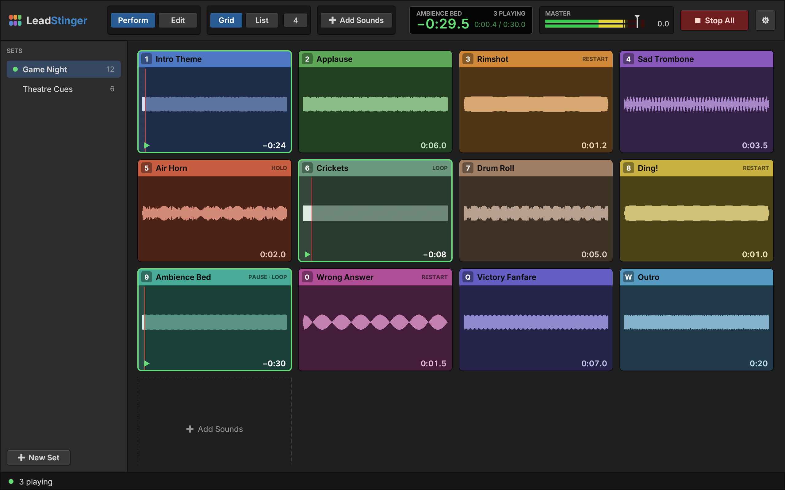
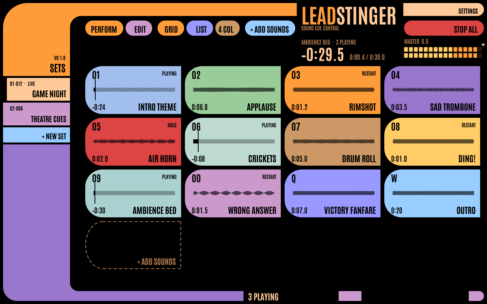

# LeadStinger

*A pun on "lead singer": a stinger is a short sound cue.* LeadStinger is a live
soundboard for macOS and Linux. It fires sound clips instantly from a grid of tiles or
a cue list, for podcasts, streams, theatre and game nights. Everything it does can also
be scripted from the command line, so key binds, Stream Deck buttons and AI agents can
drive it.





The cue list in both themes: [Console](docs/screenshots/console-list.png), [Panel](docs/screenshots/panel-list.png).

It's written in Rust, with [egui](https://github.com/emilk/egui) for the interface,
[cpal](https://github.com/RustAudio/cpal) for audio output and
[symphonia](https://github.com/pdeljanov/Symphonia) for decoding. [SPEC.md](SPEC.md)
describes how it behaves.

Originally made as a gift for Chris Fisher.

## Features

- **Sets**: named boards in a sidebar. Sounds keep playing when you switch sets.
- **Grid and cue list**: the cue list has GO (Space), a next-cue pointer and optional
  auto-advance.
- **Per-tile settings**: hotkey, colour, volume, fade in and out, loop, trim (on a
  waveform), solo, and a play mode: Play/Stop, Always Restart, Hold to Play or
  Play/Pause. Every setting is non-destructive; audio files are never modified.
- **Tile visuals**: every tile shows the waveform of the region it plays. A tile can
  also have a picture or icon, under or over the waveform. Cover art embedded in MP3,
  M4A and FLAC files is used automatically as a faint underlay.
- **Perform and Edit modes**: Perform plays tiles when you click them. Edit selects them
  for the inspector and lets you drag to reorder.
- **Getting sounds in**: drag and drop from the file manager, copy files there and paste
  them here (⌘/Ctrl+V), or use Add Sounds…. WAV, AIFF, MP3, AAC/M4A, FLAC and Ogg Vorbis.
  Files are copied into the library, so it's self-contained.
- **Mixing**: per-sample fades, resampling, gapless loops, master volume, Stop All (Esc)
  and a choice of output device.
- **Two themes**: *Console*, a dark mixing-desk look (with Light and System
  appearances), and *Panel*, a retro sci-fi control panel set in condensed capitals.
  Choose in View ▸ Theme or Settings.
- **Menus**: the native menu bar on macOS and a menu bar in the window on Linux, built
  from one model, so every item and shortcut matches.
- **Scriptable**: every action is a command for `leadstinger-cli`. It drives the running
  app, or edits the library while the app is closed.
- **Headless**: `leadstinger-cli serve` plays with no window, for a box with speakers
  and no screen.
- **Starter packs**: hand someone a ready-made board that fills their library on first
  launch. See [starter/README.md](starter/README.md).

## Install

### Nix (Linux, and macOS on Apple silicon)

```bash
nix run github:weckere/leadstinger
```

or add it to a profile, which also installs `leadstinger-cli` and, on Linux, a launcher
entry and icon:

```bash
nix profile install github:weckere/leadstinger
```

### Release downloads

The [releases page](https://github.com/weckere/leadstinger/releases) has:

- **macOS**: `LeadStinger.app` (universal), zipped. It isn't notarised, so the first
  time, right-click it in Finder and choose Open. `leadstinger-cli` is inside the
  bundle, in `Contents/MacOS/`; link it onto your PATH with
  `ln -s /Applications/LeadStinger.app/Contents/MacOS/leadstinger-cli ~/.local/bin/`.
- **Linux** (x86_64 and aarch64): an AppImage, and a tarball with both binaries, the
  `.desktop` file and the icon.

### From source

You need a Rust toolchain (1.89 or newer). On Linux you also need the development
packages for ALSA, xkbcommon, Wayland, X11 (Xcursor, Xi, Xrandr), OpenGL and GTK 3, plus
`pkg-config`. With Nix, `nix develop` gives you all of it:

```bash
nix develop -c cargo run --release
```

To make a macOS app bundle in `dist/`:

```bash
nix develop -c scripts/bundle-macos.sh
```

To make a Linux AppImage in `dist/` (needs Nix):

```bash
scripts/build-appimage.sh
```

To try it with a generated demo library, without touching your own:

```bash
LEADSTINGER_DATA_DIR=/tmp/ls-demo LEADSTINGER_DEMO=1 cargo run --release
```

## Keys

| Key | Action |
|---|---|
| tile hotkey | trigger that tile (the defaults follow the keyboard rows: `1`–`0`, `Q`–`P`, `A`–`;`, `Z`–`/`) |
| Space | GO: play the next cue (list view) |
| Esc / Shift+Esc | Stop All with a fade / at once |
| ⌘/Ctrl + O | add sounds |
| ⌘/Ctrl + V | paste sounds copied in a file manager (outside text fields) |
| ⌘/Ctrl + Shift+N | new set |
| ⌘/Ctrl + E | switch Perform and Edit |
| ⌘/Ctrl + 1 / 2 | grid / list view |
| ⌘/Ctrl + , | settings |

## The command line

`leadstinger-cli` runs any of the app's commands. With the app open it acts on the
running app; with the app closed it edits the library directly.

```bash
leadstinger-cli trigger "Air Horn"          # exactly like pressing the tile's hotkey
leadstinger-cli trigger key:1               # the tile whose hotkey is 1
leadstinger-cli stop-all
leadstinger-cli add ~/Sounds/*.wav --set "Podcast"
leadstinger-cli tile.set "Air Horn" --mode hold --fade-out 0.5 --color red
leadstinger-cli --json status               # what's playing, as JSON
leadstinger-cli watch                       # events as JSON lines
leadstinger-cli commands                    # everything it can do
```

`--safe` refuses anything destructive, and `--ssh HOST` runs the command on another
machine. The full reference, generated from the app's own command list, is
[docs/CLI.md](docs/CLI.md).

### AI agents

[skills/leadstinger/SKILL.md](skills/leadstinger/SKILL.md) is an agent skill that teaches
a coding agent (Claude Code, or anything that reads `SKILL.md` files) to drive the app
through the CLI: build a board from a folder of sounds, trim and colour tiles, run a
show. Copy or link it into your agent's skills folder. Pair it with `--safe` if the agent
shouldn't delete anything.

## Linux notes

On Linux, audio goes through ALSA, so it works with PipeWire (`pipewire-alsa`) and
PulseAudio. Both X11 and Wayland are supported.

### Hyprland and other Wayland compositors

- **Key binds** fire clips from any workspace without focusing the app. In the Lua
  config of Hyprland 0.56+ (`hyprland.lua`):

  ```lua
  hl.bind("F13", hl.dsp.exec_cmd("leadstinger-cli trigger key:1"))
  hl.bind("F14", hl.dsp.exec_cmd("leadstinger-cli trigger 'Air Horn'"))
  hl.bind("SUPER + Escape", hl.dsp.exec_cmd("leadstinger-cli stop-all"))
  ```

  or in the classic `hyprland.conf`:

  ```
  bind = , F13, exec, leadstinger-cli trigger key:1
  bind = SUPER, Escape, exec, leadstinger-cli stop-all
  ```

  The app keeps answering while its window is on another workspace.
- **Window rules**: the Wayland app id and the X11 class are both `leadstinger`, so a
  rule can match `class:^(leadstinger)$`, for example to float it or pin it to a
  workspace.
- **Launchers**: the Nix package installs `leadstinger.desktop` and an icon, so rofi,
  wofi, walker, GNOME and KDE list it.
- **Getting files in on Wayland**: the GUI toolkit (winit 0.30) can't receive file drops
  on native Wayland. Copy the files in your file manager and press Ctrl+V in the app;
  this works with Nautilus, Dolphin, Thunar, Nemo and PCManFM, and needs `wl-paste` or
  `xclip` on PATH (the Nix package brings them). If you'd rather drag, choose Settings ▸
  Window system ▸ X11 (XWayland) and restart, or start it with `LEADSTINGER_X11=1`.
  XWayland windows can look soft with fractional scaling.

### Headless show box

`leadstinger-cli serve` runs LeadStinger with no window: it plays, answers
`leadstinger-cli` and saves. The flake has a NixOS module that runs it as a user service
(so it plays through that user's PipeWire) and starts it at boot:

```nix
{
  inputs.leadstinger.url = "github:weckere/leadstinger";
  # …
  imports = [ leadstinger.nixosModules.default ];
  services.leadstinger = { enable = true; user = "kiosk"; };
}
```

See [docs/CLI.md](docs/CLI.md#headless). A NixOS VM test
(`nix build .#checks.x86_64-linux.module`) boots the module and drives it.

## Where the library lives

- macOS: `~/Library/Application Support/LeadStinger`
- Linux: `~/.local/share/leadstinger`

`LEADSTINGER_DATA_DIR` points it somewhere else. `leadstinger --help` lists every
environment setting.

## Design

The look is designed in [FigCraft](https://github.com/storytold/figcraft) and kept in
[docs/design/](docs/design/): a Python generator per theme (`mockup.py`, `panel.py`)
writes a figcraft-cli script, and the `.figcraft` and `.png` files are its output. The
colour tokens are exported to `tokens.json` and `panel-tokens.json`, and unit tests fail
if `src/theme.rs` drifts from them. To regenerate:

```bash
python3 docs/design/mockup.py LeadStinger /tmp/mockup.json "$PWD/docs/design/tokens.json"
figcraft-cli run /tmp/mockup.json --out docs/design/mockup.figcraft
figcraft-cli render docs/design/mockup.figcraft -o docs/design/mockup.png --scale 2

python3 docs/design/panel.py /tmp/panel.json "$PWD/docs/design/panel-tokens.json"
figcraft-cli run /tmp/panel.json --out docs/design/panel.figcraft
figcraft-cli render docs/design/panel.figcraft -o docs/design/panel.png --scale 2
```

`panel.py` uses a small helper, `figcraft_kit.py`; set `FIGCRAFT_KIT` to its folder.

## Development

```bash
nix develop -c cargo test        # unit and end-to-end tests
nix develop -c cargo clippy
scripts/linux-check.sh           # on a Linux host with Nix: tests, nix build, a headless screenshot
```

Run the app with `LEADSTINGER_SNAPSHOT=out.png` (and optionally `LEADSTINGER_SCRIPT` and
`LEADSTINGER_SILENT=1`) and it saves a screenshot and exits.
`LEADSTINGER_WINDOW_SIZE=940x800` opens the window at that size, for checking tiled
widths down to the 720 px minimum. `LEADSTINGER_IN_WINDOW_MENU=1` shows the Linux-style
menu bar on macOS. Use a scratch `LEADSTINGER_DATA_DIR` for all of these, never your
own library.

[AGENTS.md](AGENTS.md) has the rules for contributors, human or agent, including the
code-reuse rule. [CHANGELOG.md](CHANGELOG.md) lists what changed.

### How it was built

LeadStinger was written by several Claude Code sessions working in parallel, with one
person steering. They coordinated on a live project board: [docs/PROJECT.md](docs/PROJECT.md)
is a snapshot of it (milestones, every decision with its reasoning, tests and platforms),
and [docs/dashboard/](docs/dashboard/) is the board as a template for your own projects.

## Licence

MIT; see [LICENSE](LICENSE). The bundled fonts (Inter and Antonio) are under the SIL Open
Font License; see [ATTRIBUTION.md](ATTRIBUTION.md) for them and the design credits.
